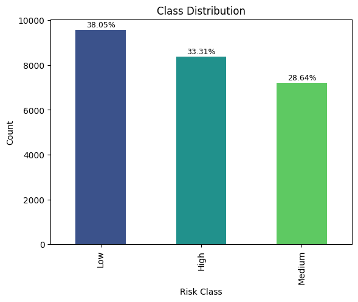
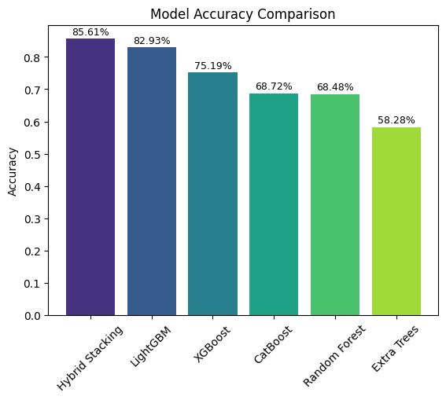
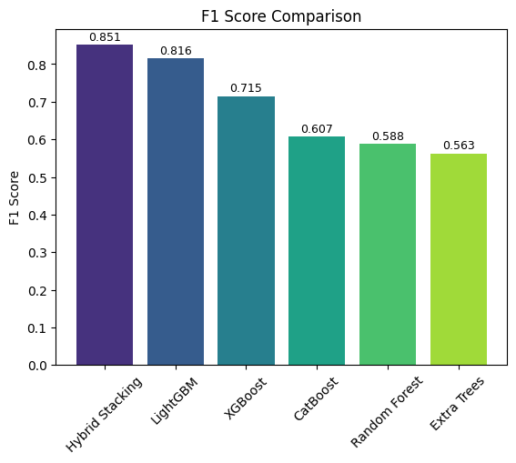
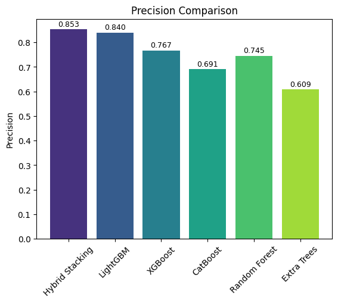
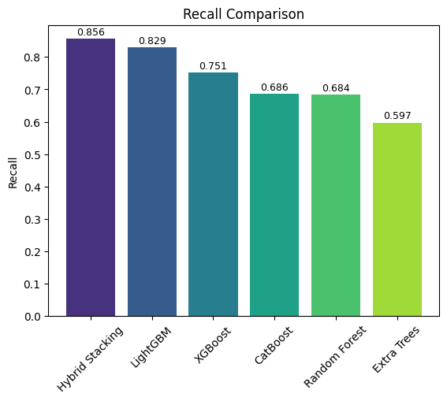
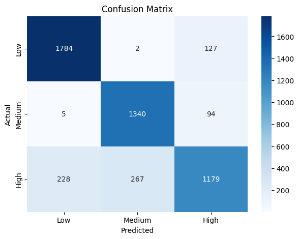

# Credit Card Approval Prediction


## 📋 Project Overview

This project implements a **hybrid stacked ensemble framework** for credit card approval prediction with multi-class risk classification. The goal is to classify applicants into three risk tiers: **Low**, **Medium**, and **High** based on composite risk indicators including income, debt levels and default history.

### Key Features

- ✅ Multi-class credit risk classification (3 classes)
- ✅ Hybrid stacked ensemble approach
- ✅ Comprehensive model evaluation
- ✅ ROC-AUC analysis per class

## 🎯 Objective

The methodology is designed to improve predictive performance for credit approval decisions while maintaining reproducibility. The final workflow combines:

1. **Data Preprocessing** - Encoding, scaling and balancing
2. **Feature Engineering** - Composite risk score calculation
3. **Ensemble Learning** - Stacked models with multiple base learners
4. **Comprehensive Evaluation** - Multiple metrics for model performance

## 📊 Methodological Framework

### 1. Data Loading & Inspection

The dataset (`Application_Data.csv`) is loaded and inspected for:

- Dimensions (rows × columns)
- Data types and missing values
- Target class distribution

### 2. Preprocessing Pipeline

- **Missing Value Handling**: Forward fill then backward fill
- **Encoding**: Label encoding for categorical variables
- **Scaling**: StandardScaler normalization
- **Splitting**: 80/20 stratified train-test split

### 3. Risk Score Calculation

A composite risk score is created using:

```
Risk Score = (Bad Debt × 0.5) + (1 - Normalized Income × 0.3) + (Default History × 0.2)
```

This balanced approach creates three risk classes:

- **Class 0 (Low Risk)**
- **Class 1 (Medium Risk)**
- **Class 2 (High Risk)**

### 4. Base Models

Five base models are trained with optimized hyperparameters:

| Model             | Key Parameters                                    |
| ----------------- | ------------------------------------------------- |
| **Random Forest** | n_estimators=100, max_depth=8, balanced subsample |
| **Extra Trees**   | n_estimators=100, max_depth=8, balanced subsample |
| **XGBoost**       | n_estimators=150, learning_rate=0.1, max_depth=5  |
| **LightGBM**      | n_estimators=200, learning_rate=0.08, max_depth=7 |
| **CatBoost**      | iterations=150, depth=5, auto_class_weights       |

### 5. Stacked Ensemble

- **Base Models**: RF, ET, XGB, LGB, CatBoost
- **Meta-Learner**: Logistic Regression (C=0.5, class_weight='balanced')
- **Cross-Validation**: 5-fold CV for robustness

### 6. Evaluation Metrics

Models are evaluated using:

- ✓ Accuracy
- ✓ Precision (macro)
- ✓ Recall (macro)
- ✓ F1-Score (macro)
- ✓ Confusion Matrix
- ✓ ROC-AUC Curves (per class)
- ✓ Classification Reports

## 📈 Results

### Class Distribution



### Model Performance Comparison

#### Accuracy



#### F1 Score



#### Precision



#### Recall



### Confusion Matrix



### ROC-AUC Curves


### Framework Visualization


## 🛠️ Technologies Used

- **Python 3.8+**
- **Data Processing**: pandas, numpy
- **Visualization**: matplotlib, seaborn
- **Preprocessing**: scikit-learn
- **Modeling**:
  - Random Forest
  - Extra Trees
  - Logistic Regression
  - XGBoost
  - LightGBM
  - CatBoost
- **Metrics**: scikit-learn classification metrics

## 📁 Project Structure

```
.
├── Application_Data.csv                              # Input dataset
├── Credit Card Approval Prediction.ipynb             # Main notebook
├── README.md                                         # This file
├── LICENSE                                           # MIT License
├── .gitignore                                        # Git ignore rules
├── figures/                                          # Output visualizations
   ├── Accuracy.png
   ├── F1.png
   ├── Precision.png
   ├── Recall.png
   ├── CM.png
   ├── ROC-AUC Curve.png
   ├── Class_Distriution.png
   ├── Framework.png
   └── Framework HD.png


```

## 🚀 Getting Started

### Prerequisites

```bash
pip install pandas numpy scikit-learn xgboost lightgbm catboost matplotlib seaborn imbalanced-learn
```

### Running the Project

1. Ensure `Application_Data.csv` is in the project directory
2. Open `Credit_Card_Approval_Prediction_3_Class.ipynb` in Jupyter Notebook
3. Run all cells sequentially to:
   - Load and preprocess data
   - Create risk classes
   - Train base models
   - Build stacked ensemble
   - Generate evaluation metrics and visualizations

## 📊 Key Findings

- **Hybrid Stacking** demonstrates superior performance by combining multiple base learners
- **Class Balance**: Balanced class weights effectively handle imbalanced data
- **ROC-AUC Analysis**: Multi-class ROC curves show good discrimination across all risk tiers
- **Macro Metrics**: Macro-averaged metrics ensure fair evaluation across all classes

## 🔄 Reproducibility

To ensure reproducibility:

- Random seeds are fixed (random_state=42)
- Stratified splitting preserves class distributions
- Sample weights are computed before model training
- All model parameters are explicitly documented

## 📝 License

This project is licensed under the MIT License - see the [LICENSE](LICENSE) file for details.

## 👤 Author
- [Nusrat Faraezi Ivy](https://github.com/ivyfaraezi)
- [Turjo Das Dip](https://github.com/tuRjoX)
- [Khadija Akter](https://github.com/khadija-akter217)
- [Iqramul Kabir](https://github.com/iKabir7)


